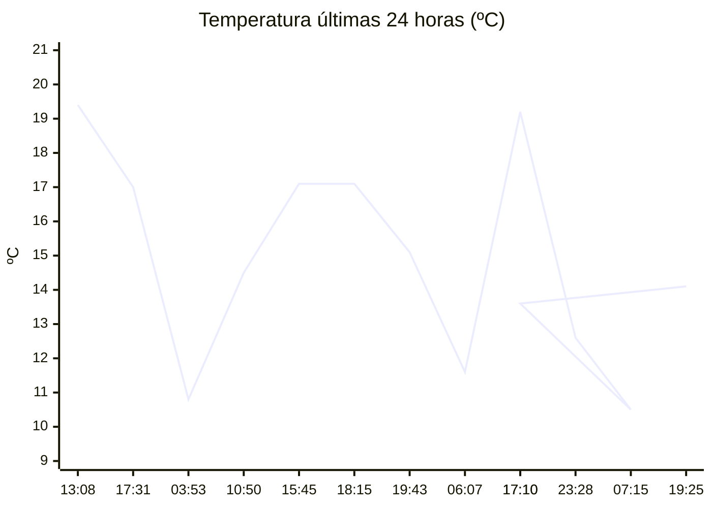

# rem-scrap

Actualización automática del clima para la estación Concarán.

## Últimos datos

| Campo | Valor |
| --- | --- |
| Estación | Concarán |
| Hora | 19:24 |
| Temperatura | 14,1 ºC |
| Humedad | 85,3 % |
| Lluvia (1h) | 0,0 mm |
| Lluvia (24h) | 0,9 mm |
| Lluvia (30d) | 26,6 mm |
| Lluvia (Año) | 538,5 mm |
| Rad. Solar | 0,0 W/m2 |
| Temp Max Hoy | 18 ºC a las 15:56 |
| Temp Min Hoy | 9 ºC a las 05:54 |
| VPS (VPD) | 0.24 kPa (bajo) |

## Resumen IA

Estación Concarán, 19:24 – la tarde se presenta fresca y muy húmeda, con ausencia de sol.  

Temperatura actual 14,1 ºC, situada entre la máxima de 18 ºC alcanzada a las 15:56 y la mínima de 9 ºC a las 05:54. El rango térmico del día es de 9 ºC; el valor actual está a 3,9 ºC de la máxima y a 5,1 ºC de la mínima, por lo que se aproxima más al extremo cálido del día.  

La humedad relativa es 85,3 % y el VPD es 0,24 kPa, valor bajo (<0,8 kPa). El aire está poco demandante, la transpiración de las plantas es limitada y el entorno favorece la proliferación de hongos por la humedad estancada.  

En la última hora no cayó lluvia, pero en las últimas 24 h se registraron 0,9 mm, lo que contribuye al alto nivel de humedad. La radiación solar es nula a esta hora, indicando ausencia de energía solar directa.  

Recomendación: evitar riegos nocturnos y favorecer la ventilación para reducir la humedad y prevenir enfermedades fúngicas.

## Tendencia últimas 24 h

## Fuente

Datos extraídos de [clima.sanluis.gob.ar](https://clima.sanluis.gob.ar/Estacion.aspx?estacion=8).

## Generado automáticamente

Este archivo fue actualizado el 13 de octubre de 2026 a las 10:25:55.
