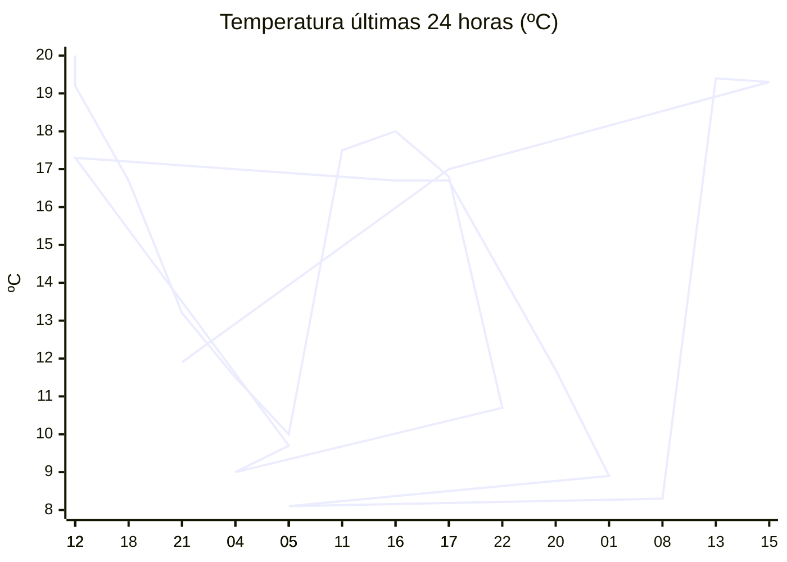

# rem-scrap

Actualización automática del clima para la estación Concarán.

## Últimos datos

| Campo | Valor |
| --- | --- |
| Estación | Concarán |
| Hora | 21:08 |
| Temperatura | 11,9 ºC |
| Humedad | 84,0 % |
| Lluvia (1h) | 0,0 mm |
| Lluvia (24h) | 4,6 mm |
| Lluvia (30d) | 40,5 mm |
| Lluvia (Año) | 534,2 mm |
| Rad. Solar | 0,0 W/m2 |
| Temp Max Hoy | 21 ºC a las 14:51 |
| Temp Min Hoy | 8 ºC a las 06:57 |
| VPS (VPD) | 0.22 kPa (bajo) |

## Resumen IA

Estación Concarán, 21:08 – noche fresca y muy húmeda, con temperatura de 11,9 ºC y humedad relativa del 84 %.  

Temperatura: la máxima de hoy fue 21 ºC y la mínima 8 ºC, lo que genera un rango térmico de 13 ºC. La temperatura actual está a 9,1 ºC de la máxima y a 3,9 ºC de la mínima, por lo que se aproxima más al extremo frío del día.  

Humedad y vapor: con 84 % de humedad y un VPD de 0,22 kPa (valor bajo), el aire está poco demandante; la transpiración de las plantas será reducida y el riesgo de desarrollo de hongos por humedad estancada es elevado.  

Lluvia y radiación: no hubo precipitación en la última hora, pero 4,6 mm cayeron en las últimas 24 h, lo que refuerza la humedad del suelo y del aire. La radiación solar es nula a esta hora, indicando ausencia de luz solar directa.  

Recomendación: favorezca la ventilación nocturna y evite riegos foliares para reducir el riesgo de enfermedades fúngicas.

## Tendencia últimas 24 h

## Fuente

Datos extraídos de [clima.sanluis.gob.ar](https://clima.sanluis.gob.ar/Estacion.aspx?estacion=8).

## Generado automáticamente

Este archivo fue actualizado el 11 de octubre de 2026 a las 12:08:54.
