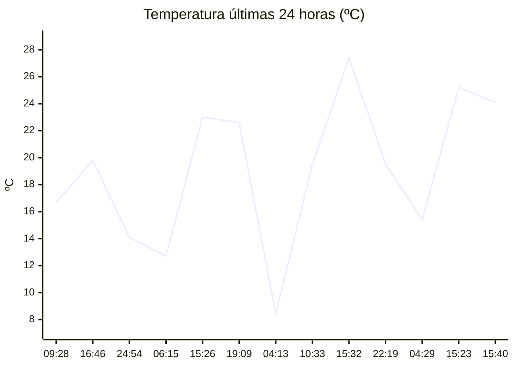

# rem-scrap

Actualización automática del clima para la estación Concarán.

## Últimos datos

| Campo | Valor |
| --- | --- |
| Estación | Concarán |
| Hora | 15:39 |
| Temperatura | 24,1 ºC |
| Humedad | 63,1 % |
| Lluvia (1h) | 0,0 mm |
| Lluvia (24h) | 4,6 mm |
| Lluvia (30d) | 40,6 mm |
| Lluvia (Año) | 552,6 mm |
| Rad. Solar | 67,0 W/m2 |
| Temp Max Hoy | 25 ºC a las 14:57 |
| Temp Min Hoy | 14 ºC a las 06:39 |
| VPS (VPD) | 1.11 kPa (ideal) |

## Resumen IA

Concarán, 15:39 hs – tarde templada y ligeramente húmeda. La temperatura actual es 24,1 ºC, apenas 0,9 ºC por debajo de la máxima de 25 ºC registrada a las 14:57, y 10,1 ºC por encima del mínimo de 14 ºC de la madrugada; el rango térmico del día es de 11 ºC y el aire se sitúa muy cerca del extremo cálido. La humedad relativa se mantiene en 63,1 %, y el VPD de 1,11 kPa está dentro del rango ideal (0,8‑1,2 kPa) para el crecimiento vegetativo, lo que indica una demanda hídrica moderada y bajo riesgo de estrés por transpiración o de enfermedades por exceso de humedad. No hubo precipitación en la última hora, pero 4,6 mm cayeron en las últimas 24 hs, lo que contribuye a la humedad ambiente sin generar encharcamiento. La radiación solar de 67 W/m² a esta hora sugiere sol moderado, probablemente bajo nubes parciales. Recomiendo mantener riego ligero y buena ventilación para aprovechar la humedad adecuada sin generar exceso de humedad en el cultivo.

## Tendencia últimas 24 h

## Fuente

Datos extraídos de [clima.sanluis.gob.ar](https://clima.sanluis.gob.ar/Estacion.aspx?estacion=8).

## Generado automáticamente

Este archivo fue actualizado el 22 de octubre de 2026 a las 06:40:52.
