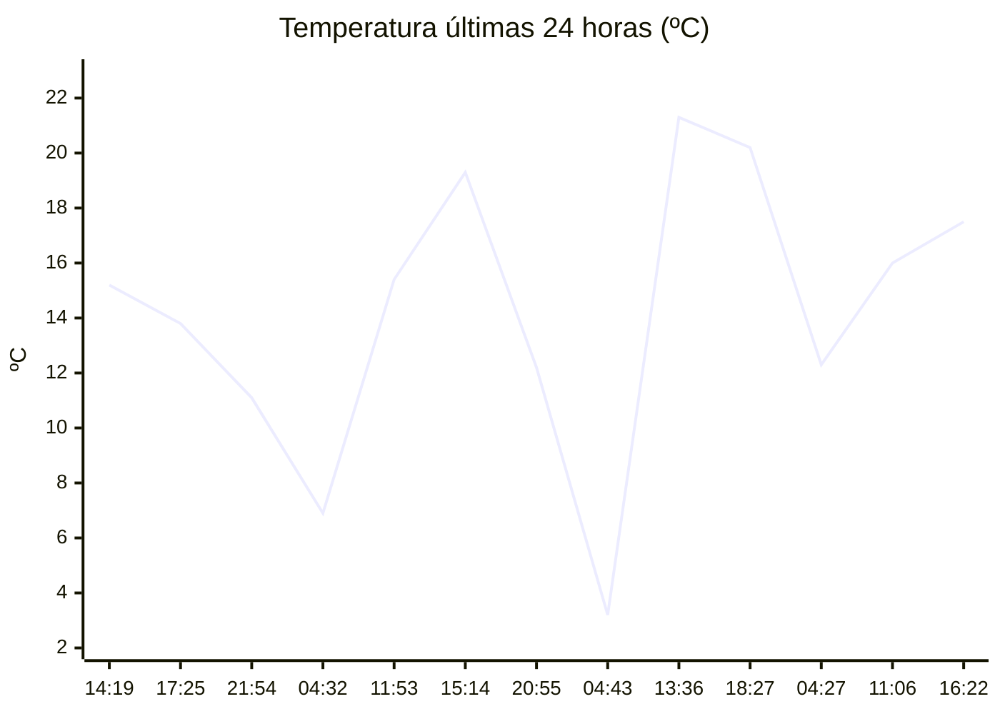

# rem-scrap

Actualización automática del clima para la estación Concarán.

## Últimos datos

| Campo | Valor |
| --- | --- |
| Estación | Concarán |
| Hora | 16:21 |
| Temperatura | 17,5 ºC |
| Humedad | 60,8 % |
| Lluvia (1h) | 0,0 mm |
| Lluvia (24h) | 0,7 mm |
| Lluvia (30d) | 43,5 mm |
| Lluvia (Año) | 555,5 mm |
| Rad. Solar | 84,0 W/m2 |
| Temp Max Hoy | 19 ºC a las 14:59 |
| Temp Min Hoy | 11 ºC a las 03:23 |
| VPS (VPD) | 0.78 kPa (bajo) |

## Resumen IA

Estación Concarán, 16:21 – tarde fresca y ligeramente húmeda, con cielo parcialmente nublado y sol moderado.  
Temperatura actual 17,5 ºC se sitúa a solo 1,5 ºC del máximo del día (19 ºC) y a 6,5 ºC de la mínima (11 ºC); el rango térmico del día es de 8 ºC, y la medida del momento se aproxima más al extremo cálido.  
Humedad relativa 60,8 % acompañada de un VPD de 0,78 kPa, valor bajo (< 0,8 kPa). El aire presenta poca demanda hídrica, lo que favorece la transpiración reducida y eleva el riesgo de desarrollo de hongos si la humedad persiste.  
Lluvia en la última hora 0,0 mm, pero 0,7 mm en las últimas 24 h, lo que aporta ligera humedad al suelo y al aire. La radiación solar de 84,0 W/m2 a esta hora indica sol moderado, insuficiente para evaporaciones intensas.  
Recomendación: mantenga una ventilación ligera y evite riegos excesivos para prevenir problemas de hongos.

## Tendencia últimas 24 h

## Fuente

Datos extraídos de [clima.sanluis.gob.ar](https://clima.sanluis.gob.ar/Estacion.aspx?estacion=8).

## Generado automáticamente

Este archivo fue actualizado el 27 de octubre de 2026 a las 07:22:38.
