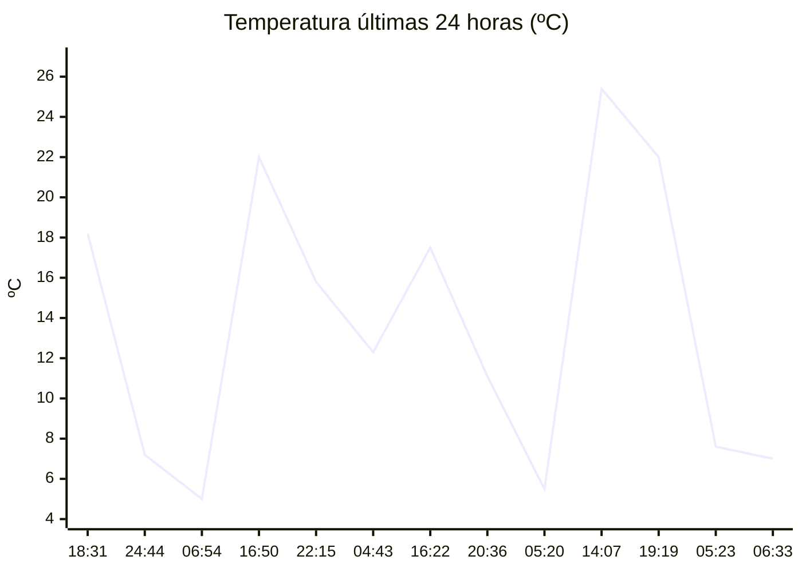

# rem-scrap

Actualización automática del clima para la estación Concarán.

## Últimos datos

| Campo | Valor |
| --- | --- |
| Estación | Concarán |
| Hora | 06:31 |
| Temperatura | 7,0 ºC |
| Humedad | 99,8 % |
| Lluvia (1h) | 0,0 mm |
| Lluvia (24h) | 0,0 mm |
| Lluvia (30d) | 43,0 mm |
| Lluvia (Año) | 555,6 mm |
| Rad. Solar | 0,0 W/m2 |
| Temp Max Hoy | 12 ºC a las 00:06 |
| Temp Min Hoy | 7 ºC a las 05:38 |
| VPS (VPD) | 0 kPa (bajo) |

## Resumen IA

Concarán, 06:31, inicio de la mañana con aire muy húmedo y sin luz solar.  
Temperatura actual 7,0 ºC coincide con la mínima del día (7 ºC a las 05:38) y está 5 ºC por debajo de la máxima (12 ºC a las 00:06), por lo que el clima se sitúa en el extremo frío del rango térmico del día (rango total 5 ºC).  
La humedad relativa es 99,8 % y el VPD (vps) registra 0 kPa, lo que indica aire saturado: la transpiración de las plantas será mínima y el riesgo de enfermedades fúngicas aumenta por la falta de déficit de vapor.  
No se registró lluvia en la última hora ni en las últimas 24 h (0,0 mm), aunque el acumulado de 30 días es 43,0 mm y el anual 555,6 mm; la ausencia de precipitación reciente mantiene la humedad alta. La radiación solar es 0,0 W/m2, típica de la madrugada.  
Recomendación: evitar riegos nocturnos y asegurar buena ventilación para disminuir la humedad foliar y prevenir hongos.

## Tendencia últimas 24 h

## Fuente

Datos extraídos de [clima.sanluis.gob.ar](https://clima.sanluis.gob.ar/Estacion.aspx?estacion=8).

## Generado automáticamente

Este archivo fue actualizado el 29 de octubre de 2026 a las 09:33:05.
