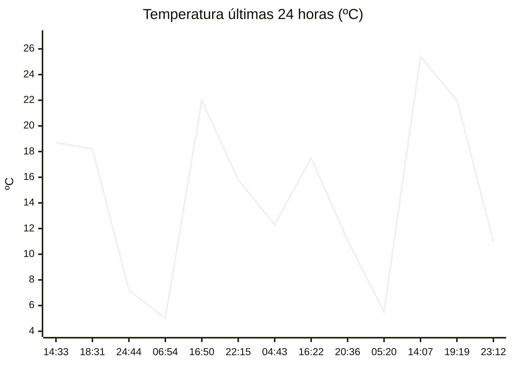

# rem-scrap

Actualización automática del clima para la estación Concarán.

## Últimos datos

| Campo | Valor |
| --- | --- |
| Estación | Concarán |
| Hora | 23:11 |
| Temperatura | 11,0 ºC |
| Humedad | 90,6 % |
| Lluvia (1h) | 0,0 mm |
| Lluvia (24h) | 0,1 mm |
| Lluvia (30d) | 43,0 mm |
| Lluvia (Año) | 555,6 mm |
| Rad. Solar | 0,0 W/m2 |
| Temp Max Hoy | 27 ºC a las 16:03 |
| Temp Min Hoy | 5 ºC a las 05:51 |
| VPS (VPD) | 0.12 kPa (bajo) |

## Resumen IA

Concarán, 23:11, noche fresca y muy húmeda.  
Temperatura actual 11,0 ºC se sitúa dentro del rango diario de 5 ºC a 27 ºC (rango de 22 ºC); está a 6 ºC del mínimo y a 16 ºC del máximo, por lo que se aproxima más al extremo bajo del día.  
Humedad relativa 90,6 % acompañada de un VPD de 0,12 kPa, valor muy bajo que indica aire poco demandante y favorece la retención de humedad, aumentando el riesgo de desarrollo de hongos en cultivos o superficies húmedas.  
En la última hora no cayó lluvia y en las últimas 24 h se registraron apenas 0,1 mm, pero la precipitación reciente mantiene la atmósfera saturada. La radiación solar es 0 W/m2, como corresponde a la hora nocturna, sin aporte de energía solar.  
Recomendación: ventilar el invernadero o los cultivos durante la madrugada para reducir la humedad y prevenir problemas fúngicos, sin necesidad de riego adicional.

## Tendencia últimas 24 h

## Fuente

Datos extraídos de [clima.sanluis.gob.ar](https://clima.sanluis.gob.ar/Estacion.aspx?estacion=8).

## Generado automáticamente

Este archivo fue actualizado el 29 de octubre de 2026 a las 02:12:54.
