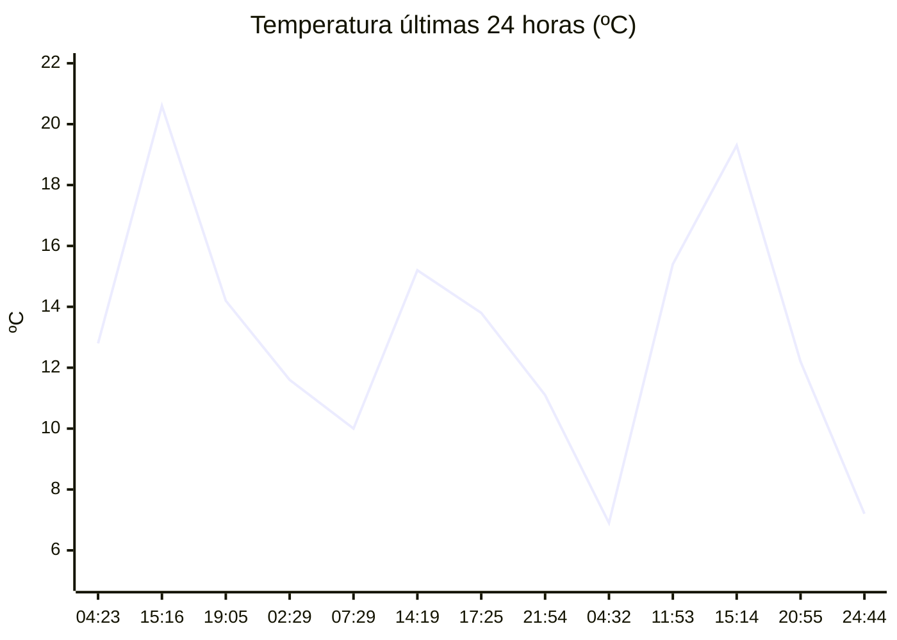

# rem-scrap

Actualización automática del clima para la estación Concarán.

## Últimos datos

| Campo | Valor |
| --- | --- |
| Estación | Concarán |
| Hora | 00:43 |
| Temperatura | 7,2 ºC |
| Humedad | 94,8 % |
| Lluvia (1h) | 0,0 mm |
| Lluvia (24h) | 0,0 mm |
| Lluvia (30d) | 42,8 mm |
| Lluvia (Año) | 554,8 mm |
| Rad. Solar | 0,0 W/m2 |
| Temp Max Hoy | 20 ºC a las 16:28 |
| Temp Min Hoy | 7 ºC a las 04:22 |
| VPS (VPD) | 0.05 kPa (bajo) |

## Resumen IA

Estación Concarán, 00:43 h – noche fresca y muy húmeda, con cielo despejado y sin luz solar.  
Temperatura actual 7,2 ºC está apenas 0,2 ºC por encima de la mínima registrada (7 ºC a las 04:22) y distante 12,8 ºC del máximo del día (20 ºC a las 16:28); el rango térmico del día es de 13 ºC, por lo que el clima de este momento se aproxima al extremo frío.  
La humedad relativa es 94,8 % y el VPD (vps) de 0,05 kPa es extremadamente bajo, lo que indica aire poco demandante y alta probabilidad de condensación; para los cultivos eso significa riesgo de desarrollo de hongos y una transpiración mínima.  
No hubo precipitación en la última hora ni en las últimas 24 h; la radiación solar es 0,0 W/m2, propia de la madrugada. La falta de lluvia reciente mantiene la humedad alta sin aporte de agua fresca.  
Recomendación: ventilar intensamente los cultivos y evitar riegos nocturnos para reducir la humedad foliar y prevenir enfermedades fúngicas.

## Tendencia últimas 24 h

## Fuente

Datos extraídos de [clima.sanluis.gob.ar](https://clima.sanluis.gob.ar/Estacion.aspx?estacion=8).

## Generado automáticamente

Este archivo fue actualizado el 26 de octubre de 2026 a las 03:44:56.
