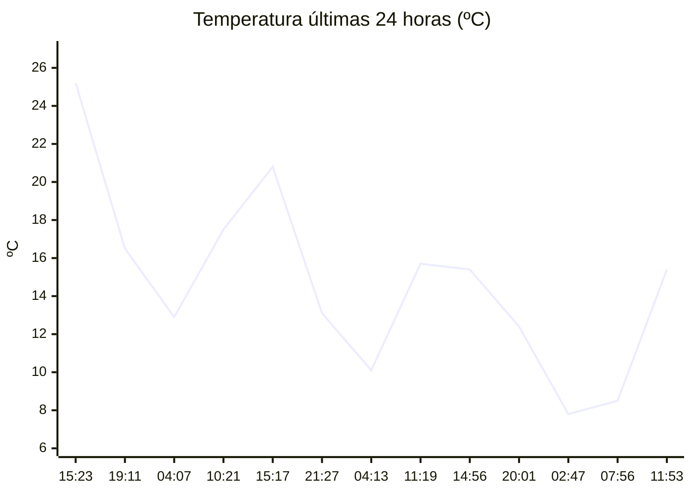

# rem-scrap

Actualización automática del clima para la estación Concarán.

## Últimos datos

| Campo | Valor |
| --- | --- |
| Estación | Concarán |
| Hora | 11:52 |
| Temperatura | 15,4 ºC |
| Humedad | 57,6 % |
| Lluvia (1h) | 0,0 mm |
| Lluvia (24h) | 0,0 mm |
| Lluvia (30d) | 42,8 mm |
| Lluvia (Año) | 554,8 mm |
| Rad. Solar | 347,0 W/m2 |
| Temp Max Hoy | 15 ºC a las 09:58 |
| Temp Min Hoy | 7 ºC a las 04:22 |
| VPS (VPD) | 0.74 kPa (bajo) |

## Resumen IA

Concarán, 11:52, mañana fresca y con buen nivel solar.  
La temperatura actual es 15,4 ºC, ligeramente superior a la máxima del día (15 ºC a las 09:58) y muy cercana al extremo caliente; el rango térmico del día es de 8 ºC entre 7 ºC mínima y 15 ºC máxima.  
La humedad relativa está en 57,6 % y el VPD de 0,74 kPa es bajo, lo que indica aire poco demandante y favorece la retención de humedad, aumentando el riesgo de desarrollo de hongos en cultivos sensibles.  
No se registró lluvia en la última hora ni en las últimas 24 h, por lo que la humedad del suelo se mantiene estable; la radiación solar de 347,0 W/m2 a esta hora señala una intensidad solar moderada‑alta, adecuada para procesos fotosintéticos.  
Se recomienda mantener una buena ventilación del cultivo y, de ser necesario, aplicar fungicidas preventivos para evitar problemas de humedad.

## Tendencia últimas 24 h

## Fuente

Datos extraídos de [clima.sanluis.gob.ar](https://clima.sanluis.gob.ar/Estacion.aspx?estacion=8).

## Generado automáticamente

Este archivo fue actualizado el 25 de octubre de 2026 a las 02:53:56.
