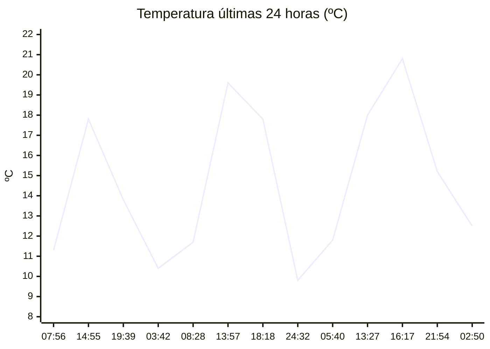

# rem-scrap

Actualización automática del clima para la estación Concarán.

## Últimos datos

| Campo | Valor |
| --- | --- |
| Estación | Concarán |
| Hora | 02:49 |
| Temperatura | 12,5 ºC |
| Humedad | 86,9 % |
| Lluvia (1h) | 0,0 mm |
| Lluvia (24h) | 0,0 mm |
| Lluvia (30d) | 36,0 mm |
| Lluvia (Año) | 548,1 mm |
| Rad. Solar | 0,0 W/m2 |
| Temp Max Hoy | 15 ºC a las 00:54 |
| Temp Min Hoy | 13 ºC a las 01:57 |
| VPS (VPD) | 0.19 kPa (bajo) |

## Resumen IA

Concarán, 02:49 – La noche se muestra fresca y muy húmeda.  

Temperatura actual 12,5 ºC está por debajo de la mínima del día (13 ºC a la 01:57) y alejada de la máxima de 15 ºC (a la 00:54). El rango térmico del día es de 2 ºC; el valor presente se aproxima más al extremo mínimo (diferencia 0,5 ºC contra 2,5 ºC al máximo).  

La humedad relativa es del 86,9 %. El VPD registrado es 0,19 kPa, muy bajo; indica que el aire tiene poca demanda de vapor, lo que favorece la transpiración mínima pero aumenta el riesgo de desarrollo de hongos por exceso de humedad. Para las plantas, el ambiente es poco estresante en términos de deshidratación, pero se debe vigilar la aparición de patógenos.  

No hubo precipitación en la última hora ni en las últimas 24 h; la radiación solar es nula, propia de la madrugada.  

Recomendación: mantenga una buena ventilación nocturna y evite riegos intensos ahora para reducir la probabilidad de enfermedades fúngicas.

## Tendencia últimas 24 h

## Fuente

Datos extraídos de [clima.sanluis.gob.ar](https://clima.sanluis.gob.ar/Estacion.aspx?estacion=8).

## Generado automáticamente

Este archivo fue actualizado el 19 de octubre de 2026 a las 05:50:52.
