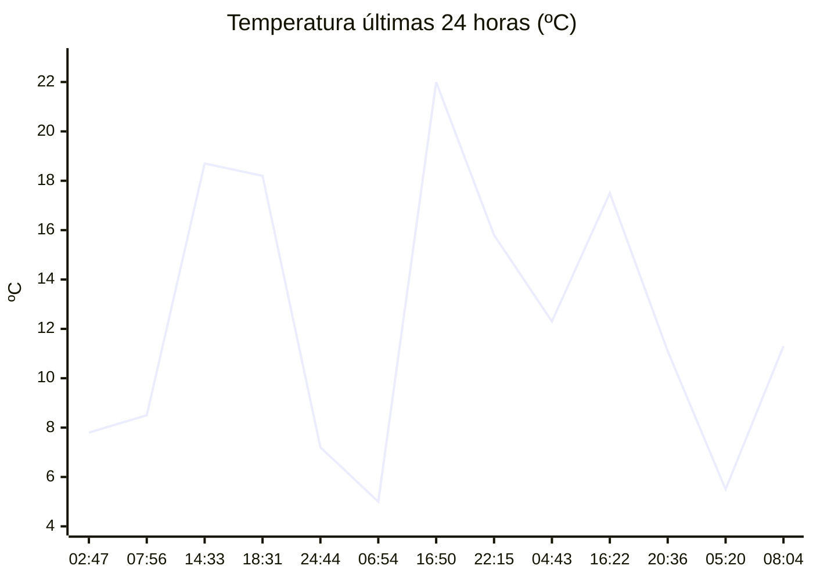

# rem-scrap

Actualización automática del clima para la estación Concarán.

## Últimos datos

| Campo | Valor |
| --- | --- |
| Estación | Concarán |
| Hora | 08:03 |
| Temperatura | 11,3 ºC |
| Humedad | 98,2 % |
| Lluvia (1h) | 0,0 mm |
| Lluvia (24h) | 0,9 mm |
| Lluvia (30d) | 43,0 mm |
| Lluvia (Año) | 555,6 mm |
| Rad. Solar | 254,0 W/m2 |
| Temp Max Hoy | 11 ºC a las 07:59 |
| Temp Min Hoy | 5 ºC a las 05:51 |
| VPS (VPD) | 0.02 kPa (bajo) |

## Resumen IA

Estación Concarán, 08:03 h – la mañana se presenta fresca y extremadamente húmeda.  
Temperatura: la medida actual es 11,3 ºC, ligeramente superior a la máxima del día (11 ºC a 07:59) y muy distante de la mínima (5 ºC a 05:51). El rango térmico del día es de 6 ºC; la temperatura actual se ubica casi en el extremo superior del rango.  
Humedad y vapor: la humedad relativa es 98,2 % y el VPD es 0,02 kPa, valor muy bajo (<0,8 kPa). Esto indica que el aire tiene escasa demanda de agua, favoreciendo una transpiración mínima pero también aumentando el riesgo de desarrollo de hongos por la humedad estancada.  
Lluvia y radiación: se registraron 0,0 mm en la última hora y 0,9 mm en las últimas 24 h, lo que mantiene el suelo húmedo y refuerza la alta humedad del ambiente. La radiación solar de 254,0 W/m2 a esta hora es moderada, típica de un inicio de día.  
Recomendación: posponer riegos y favorecer la ventilación del cultivo para reducir la presión de humedad y evitar problemas fúngicos.

## Tendencia últimas 24 h

## Fuente

Datos extraídos de [clima.sanluis.gob.ar](https://clima.sanluis.gob.ar/Estacion.aspx?estacion=8).

## Generado automáticamente

Este archivo fue actualizado el 28 de octubre de 2026 a las 11:04:27.
