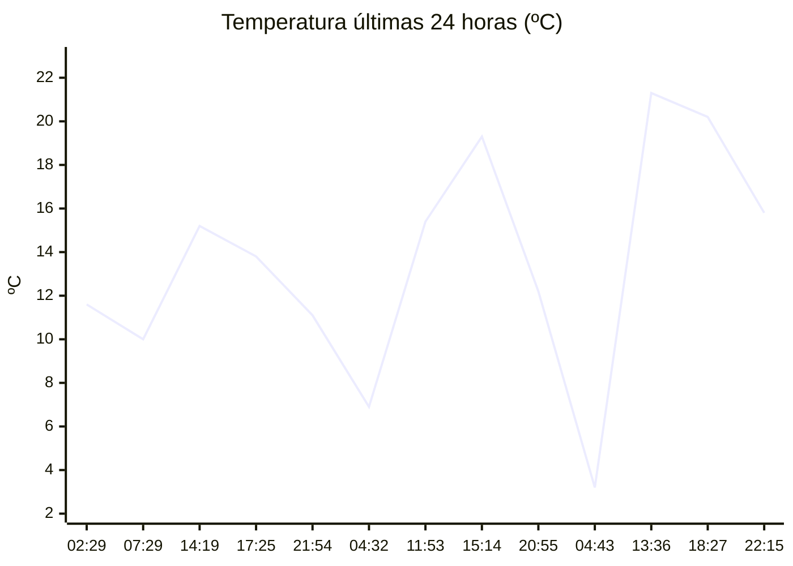

# rem-scrap

Actualización automática del clima para la estación Concarán.

## Últimos datos

| Campo | Valor |
| --- | --- |
| Estación | Concarán |
| Hora | 22:14 |
| Temperatura | 15,8 ºC |
| Humedad | 68,9 % |
| Lluvia (1h) | 0,0 mm |
| Lluvia (24h) | 0,0 mm |
| Lluvia (30d) | 42,8 mm |
| Lluvia (Año) | 554,8 mm |
| Rad. Solar | 0,0 W/m2 |
| Temp Max Hoy | 24 ºC a las 17:18 |
| Temp Min Hoy | 3 ºC a las 05:03 |
| VPS (VPD) | 0.56 kPa (bajo) |

## Resumen IA

Estación Concarán, 22:14 h – noche fresca y bastante húmeda.  

Temperatura actual 15,8 ºC está a 8,2 ºC del máximo de 24 ºC y a 12,8 ºC del mínimo de 3 ºC; el rango térmico del día fue de 21 ºC y la medida del momento se sitúa más cerca del extremo máximo.  

La humedad relativa es 68,9 % y el VPD (vps) es 0,56 kPa, un valor bajo que indica aire poco demandante para la transpiración y favorece la persistencia de humedad en el follaje, aumentando el riesgo de enfermedades fúngicas.  

No se registró lluvia en la última hora ni en las últimas 24 h; la radiación solar es 0 W/m2, como corresponde a la hora nocturna, por lo que no hay aporte solar que modere la humedad.  

Recomendación: mantenga una buena ventilación nocturna y evite riegos intensos para prevenir la proliferación de hongos.

## Tendencia últimas 24 h

## Fuente

Datos extraídos de [clima.sanluis.gob.ar](https://clima.sanluis.gob.ar/Estacion.aspx?estacion=8).

## Generado automáticamente

Este archivo fue actualizado el 27 de octubre de 2026 a las 01:15:44.
