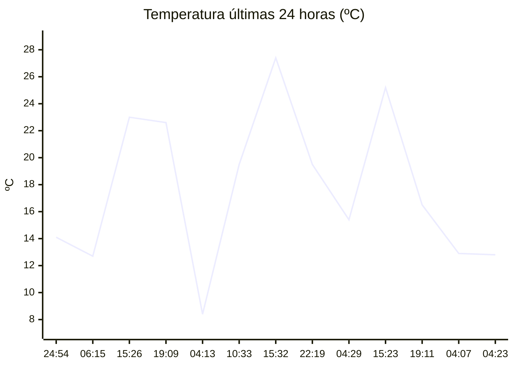

# rem-scrap

Actualización automática del clima para la estación Concarán.

## Últimos datos

| Campo | Valor |
| --- | --- |
| Estación | Concarán |
| Hora | 04:22 |
| Temperatura | 12,8 ºC |
| Humedad | 99,6 % |
| Lluvia (1h) | 0,0 mm |
| Lluvia (24h) | 2,4 mm |
| Lluvia (30d) | 40,6 mm |
| Lluvia (Año) | 552,6 mm |
| Rad. Solar | 0,0 W/m2 |
| Temp Max Hoy | 14 ºC a las 03:02 |
| Temp Min Hoy | 13 ºC a las 00:00 |
| VPS (VPD) | 0.01 kPa (bajo) |

## Resumen IA

Concarán, 04:22 h – madrugada fresca y extremadamente húmeda. La temperatura actual es 12,8 ºC, ligeramente por debajo de la mínima registrada del día (13 ºC a 00:00) y distante 1,2 ºC de la máxima de 14 ºC (03:02). El rango térmico del día es de apenas 1 ºC, y el aire se encuentra casi en el extremo frío. La humedad relativa es 99,6 % y el VPD (vps) de 0,01 kPa indica un aire con muy baja demanda de transpiración; esa condición favorece la proliferación de hongos y dificulta la evaporación. No hubo lluvia en la última hora, pero en las últimas 24 h se acumularon 2,4 mm, lo que mantiene el suelo húmedo y refuerza la alta humedad atmosférica. La radiación solar es 0,0 W/m2, propio de la hora nocturna, sin aporte de energía solar. Recomiendo ventilar el cultivo y limitar riegos nocturnos para evitar problemas fúngicos.

## Tendencia últimas 24 h

## Fuente

Datos extraídos de [clima.sanluis.gob.ar](https://clima.sanluis.gob.ar/Estacion.aspx?estacion=8).

## Generado automáticamente

Este archivo fue actualizado el 23 de octubre de 2026 a las 07:23:29.
