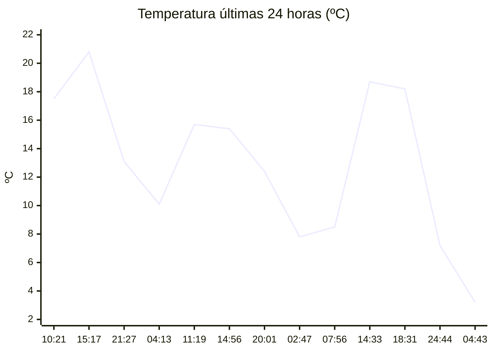

# rem-scrap

Actualización automática del clima para la estación Concarán.

## Últimos datos

| Campo | Valor |
| --- | --- |
| Estación | Concarán |
| Hora | 04:42 |
| Temperatura | 3,2 ºC |
| Humedad | 99,8 % |
| Lluvia (1h) | 0,0 mm |
| Lluvia (24h) | 0,0 mm |
| Lluvia (30d) | 42,8 mm |
| Lluvia (Año) | 554,8 mm |
| Rad. Solar | 0,0 W/m2 |
| Temp Max Hoy | 8 ºC a las 00:00 |
| Temp Min Hoy | 4 ºC a las 03:21 |
| VPS (VPD) | 0 kPa (bajo) |

## Resumen IA

Concarán, 04:42 – madrugada fría y extremadamente húmeda. La temperatura actual es 3,2 ºC; la máxima del día alcanzó 8 ºC y la mínima registrada fue 4 ºC, lo que genera un rango térmico de 4 ºC. El valor actual se sitúa muy próximo al extremo bajo del rango, incluso por debajo de la mínima oficial. La humedad relativa está en 99,8 % y el VPD (vps) es 0 kPa, lo que indica aire prácticamente saturado: la transpiración de las plantas es mínima y el riesgo de desarrollo de hongos por humedad estancada es alto. No se registró lluvia en la última hora ni en las últimas 24 h, aunque en los últimos 30 d se acumularon 42,8 mm y el total anual es 554,8 mm. La radiación solar es 0 W/m2, coherente con la hora nocturna y ausencia de luz solar directa. Se recomienda cubrir los cultivos para evitar daño por heladas y limitar riegos nocturnos; mantenga una ventilación ligera para reducir la humedad alrededor de la vegetación.

## Tendencia últimas 24 h

## Fuente

Datos extraídos de [clima.sanluis.gob.ar](https://clima.sanluis.gob.ar/Estacion.aspx?estacion=8).

## Generado automáticamente

Este archivo fue actualizado el 26 de octubre de 2026 a las 07:43:58.
