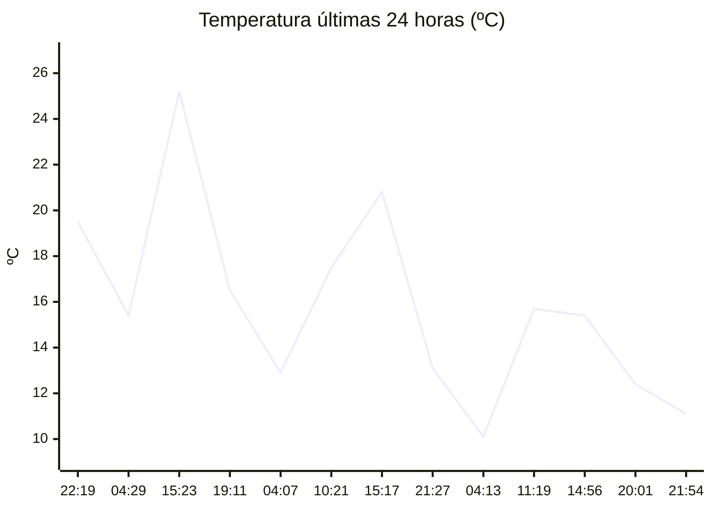

# rem-scrap

Actualización automática del clima para la estación Concarán.

## Últimos datos

| Campo | Valor |
| --- | --- |
| Estación | Concarán |
| Hora | 21:53 |
| Temperatura | 11,1 ºC |
| Humedad | 86,4 % |
| Lluvia (1h) | 0,0 mm |
| Lluvia (24h) | 2,1 mm |
| Lluvia (30d) | 42,8 mm |
| Lluvia (Año) | 554,8 mm |
| Rad. Solar | 0,0 W/m2 |
| Temp Max Hoy | 17 ºC a las 11:53 |
| Temp Min Hoy | 9 ºC a las 06:14 |
| VPS (VPD) | 0.18 kPa (bajo) |

## Resumen IA

Estación Concarán, 21:53 h – noche fresca y bastante húmeda.  
Temperatura actual 11,1 ºC, dentro del rango del día (9 ºC – 17 ºC). El rango térmico es de 8 ºC; la temperatura de este momento está a 2,1 ºC del mínimo y a 5,9 ºC del máximo, por lo que se aproxima más al extremo frío del día.  
Humedad relativa 86,4 % y VPD 0,18 kPa indican aire muy poco demandante; la baja presión de vapor de déficit favorece una transpiración mínima pero aumenta el riesgo de desarrollo de hongos por la humedad estancada.  
Lluvia en la última hora 0,0 mm, pero 2,1 mm en las últimas 24 h, lo que contribuye al alto contenido de humedad del aire. Radiación solar 0,0 W/m2, acorde a la hora nocturna, sin aporte de energía solar.  
Recomendación: ventilar el cultivo durante la madrugada para reducir la humedad y prevenir enfermedades fúngicas; no es necesario regar.

## Tendencia últimas 24 h

## Fuente

Datos extraídos de [clima.sanluis.gob.ar](https://clima.sanluis.gob.ar/Estacion.aspx?estacion=8).

## Generado automáticamente

Este archivo fue actualizado el 25 de octubre de 2026 a las 12:54:14.
