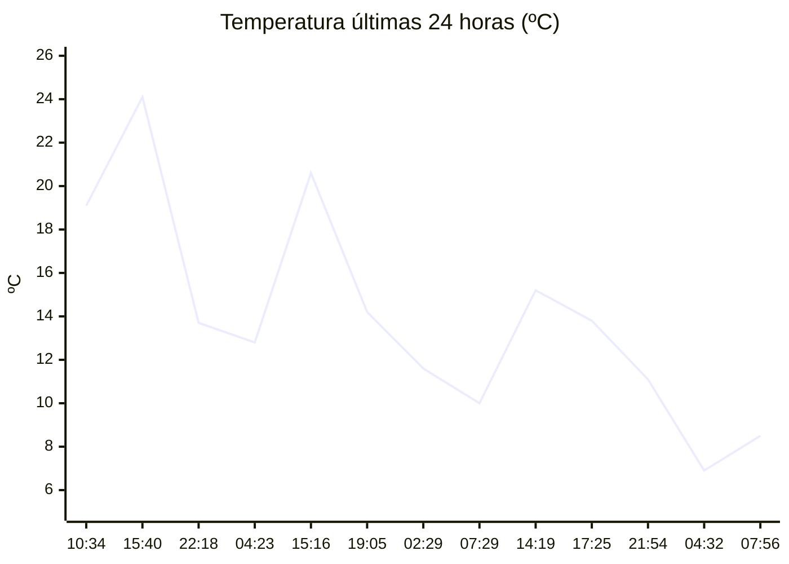

# rem-scrap

Actualización automática del clima para la estación Concarán.

## Últimos datos

| Campo | Valor |
| --- | --- |
| Estación | Concarán |
| Hora | 07:55 |
| Temperatura | 8,5 ºC |
| Humedad | 99,8 % |
| Lluvia (1h) | 0,0 mm |
| Lluvia (24h) | 0,0 mm |
| Lluvia (30d) | 42,8 mm |
| Lluvia (Año) | 554,8 mm |
| Rad. Solar | 80,0 W/m2 |
| Temp Max Hoy | 9 ºC a las 00:09 |
| Temp Min Hoy | 7 ºC a las 04:22 |
| VPS (VPD) | 0 kPa (bajo) |

## Resumen IA

Estación Concarán, 07:55 hs: mañana fresca y extremadamente húmeda.  
Temperatura actual 8,5 ºC, frente a la máxima de 9 ºC y la mínima de 7 ºC; el rango térmico del día es de 2 ºC. El valor actual está a 0,5 ºC del máximo y a 1,5 ºC del mínimo, por lo que se aproxima más al extremo cálido del día.  
Humedad relativa 99,8 % y VPD 0 kPa (valor bajo). Un VPD nulo indica aire saturado, con mínima demanda de transpiración y alta propensión a la proliferación de hongos; el estrés hídrico para las plantas es prácticamente nulo.  
No se registró lluvia en la última hora ni en las últimas 24 hs; la humedad elevada proviene del vapor atmosférico, no de precipitaciones recientes. La radiación solar de 80 W/m² a esta hora sugiere una intensidad solar todavía baja, típica de la mañana.  
Recomendación: suspender riegos y favorecer ventilación para reducir el riesgo de enfermedades fúngicas.

## Tendencia últimas 24 h

## Fuente

Datos extraídos de [clima.sanluis.gob.ar](https://clima.sanluis.gob.ar/Estacion.aspx?estacion=8).

## Generado automáticamente

Este archivo fue actualizado el 25 de octubre de 2026 a las 10:56:21.
