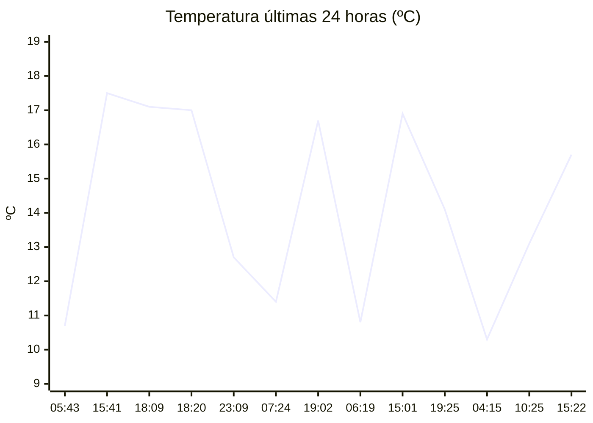

# rem-scrap

Actualización automática del clima para la estación Concarán.

## Últimos datos

| Campo | Valor |
| --- | --- |
| Estación | Concarán |
| Hora | 15:21 |
| Temperatura | 15,7 ºC |
| Humedad | 76,8 % |
| Lluvia (1h) | 0,0 mm |
| Lluvia (24h) | 2,1 mm |
| Lluvia (30d) | 28,6 mm |
| Lluvia (Año) | 540,5 mm |
| Rad. Solar | 707,0 W/m2 |
| Temp Max Hoy | 17 ºC a las 12:41 |
| Temp Min Hoy | 9 ºC a las 01:15 |
| VPS (VPD) | 0.41 kPa (bajo) |

## Resumen IA

Concarán, 15:21, tarde fresca y húmeda con cielo parcialmente despejado.  
Temperatura actual 15,7 ºC está a 1,3 ºC del máximo de 17 ºC y a 6,7 ºC de la mínima de 9 ºC; el rango térmico del día es de 8 ºC, por lo que la medida del momento se aproxima más al extremo máximo.  
Humedad relativa 76,8 % y VPD 0,41 kPa (valor bajo). Un VPD bajo indica que el aire es poco demandante para la transpiración, pero favorece la retención de humedad y aumenta el riesgo de desarrollo de hongos en el follaje.  
Lluvia en la última hora 0,0 mm, pero 2,1 mm en las últimas 24 h, lo que contribuye a la alta humedad del ambiente. La radiación solar de 707,0 W/m2 a esta hora del día señala una irradiación fuerte, aunque la temperatura sigue moderada.  
Recomendación: mantener una buena ventilación y evitar riegos adicionales mientras persista la alta humedad para prevenir enfermedades foliares.

## Tendencia últimas 24 h

## Fuente

Datos extraídos de [clima.sanluis.gob.ar](https://clima.sanluis.gob.ar/Estacion.aspx?estacion=8).

## Generado automáticamente

Este archivo fue actualizado el 14 de octubre de 2026 a las 06:22:57.
