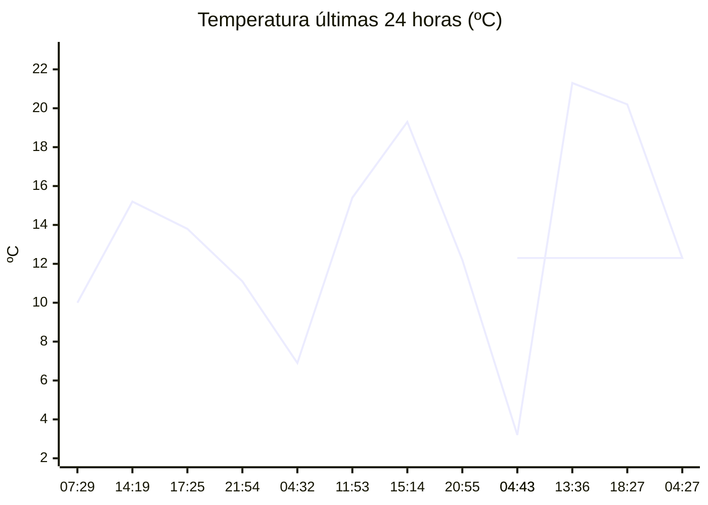

# rem-scrap

Actualización automática del clima para la estación Concarán.

## Últimos datos

| Campo | Valor |
| --- | --- |
| Estación | Concarán |
| Hora | 04:42 |
| Temperatura | 12,3 ºC |
| Humedad | 92,2 % |
| Lluvia (1h) | 0,0 mm |
| Lluvia (24h) | 0,0 mm |
| Lluvia (30d) | 42,8 mm |
| Lluvia (Año) | 554,8 mm |
| Rad. Solar | 0,0 W/m2 |
| Temp Max Hoy | 15 ºC a las 00:20 |
| Temp Min Hoy | 11 ºC a las 03:23 |
| VPS (VPD) | 0.11 kPa (bajo) |

## Resumen IA

Estación Concarán, 04:42 h – madrugada fresca y muy húmeda, sin radiación solar.  
Temperatura actual 12,3 ºC frente a la máxima de 15 ºC y la mínima de 11 ºC; el rango térmico del día es de 4 ºC. El valor actual se sitúa 1,3 ºC por encima del mínimo y 2,7 ºC bajo la máxima, por lo que está más próximo al extremo frío del día.  
Humedad relativa 92,2 % y VPD 0,11 kPa (valor bajo). Un VPD bajo indica que el aire tiene poca demanda de transpiración, favorece la retención de humedad en el follaje y eleva el riesgo de desarrollo de hongos si se mantiene la humedad elevada.  
No se registró lluvia en la última hora ni en las últimas 24 h; la precipitación acumulada en los últimos 30 d es 42,8 mm y en el año 554,8 mm. La ausencia de lluvia reciente, junto a la humedad alta, mantiene el ambiente saturado. La radiación solar es 0 W/m2, propia de la noche.  
Recomendación: ventilar ligeramente el cultivo y posponer riegos para evitar exceso de humedad que favorezca enfermedades.

## Tendencia últimas 24 h

## Fuente

Datos extraídos de [clima.sanluis.gob.ar](https://clima.sanluis.gob.ar/Estacion.aspx?estacion=8).

## Generado automáticamente

Este archivo fue actualizado el 27 de octubre de 2026 a las 07:43:23.
