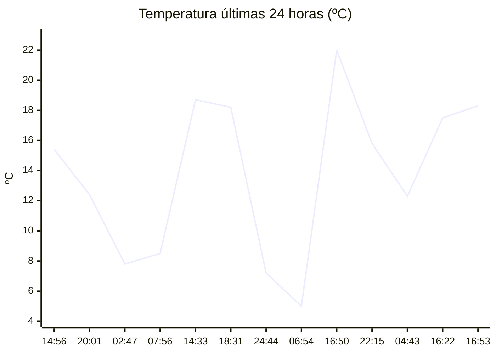

# rem-scrap

Actualización automática del clima para la estación Concarán.

## Últimos datos

| Campo | Valor |
| --- | --- |
| Estación | Concarán |
| Hora | 16:52 |
| Temperatura | 18,3 ºC |
| Humedad | 61,7 % |
| Lluvia (1h) | 0,0 mm |
| Lluvia (24h) | 0,7 mm |
| Lluvia (30d) | 43,5 mm |
| Lluvia (Año) | 555,5 mm |
| Rad. Solar | 319,0 W/m2 |
| Temp Max Hoy | 19 ºC a las 14:59 |
| Temp Min Hoy | 11 ºC a las 03:23 |
| VPS (VPD) | 0.81 kPa (ideal) |

## Resumen IA

Estación Concarán, 16:52 hs: tarde fresca y moderadamente húmeda. La temperatura actual es 18,3 ºC, apenas 0,7 ºC por debajo de la máxima de 19 ºC alcanzada a las 14:59 y 7,3 ºC sobre la mínima de 11 ºC de la madrugada; el rango térmico del día es de 8 ºC y el momento se sitúa mucho más próximo al extremo máximo. La humedad relativa está en 61,7 % y el VPD es 0,81 kPa, dentro del rango ideal (0,8‑1,2 kPa) para el desarrollo vegetativo: la transpiración es adecuada y el riesgo de hongos por exceso de humedad es bajo. No hubo lluvia en la última hora, pero sí 0,7 mm en las últimas 24 hs, lo que ayuda a mantener la humedad del suelo y del aire. La radiación solar de 319 W/m2 a esta hora indica un nivel moderado‑alto de luz, todavía suficiente para fotosíntesis. Recomendación: riego ligero y ventilación ocasional para evitar acumulación de humedad en el follaje.

## Tendencia últimas 24 h

## Fuente

Datos extraídos de [clima.sanluis.gob.ar](https://clima.sanluis.gob.ar/Estacion.aspx?estacion=8).

## Generado automáticamente

Este archivo fue actualizado el 27 de octubre de 2026 a las 07:53:45.
