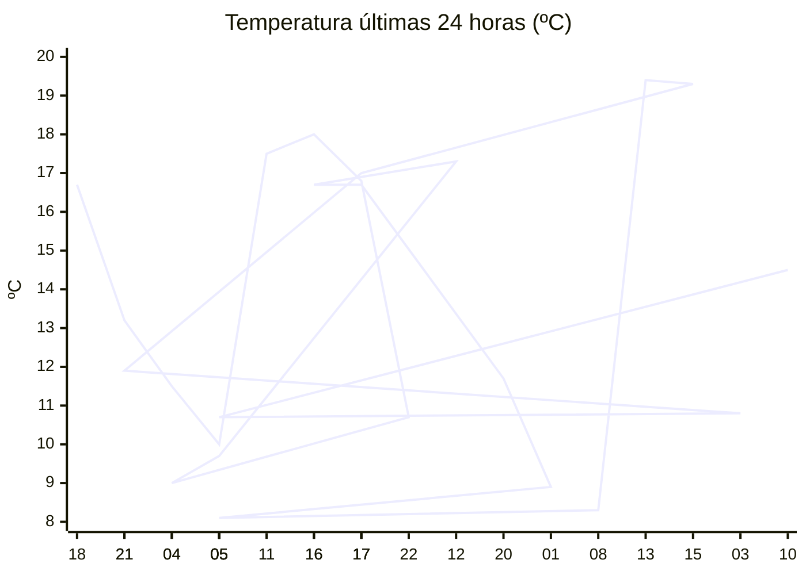

# rem-scrap

Actualización automática del clima para la estación Concarán.

## Últimos datos

| Campo | Valor |
| --- | --- |
| Estación | Concarán |
| Hora | 10:49 |
| Temperatura | 14,5 ºC |
| Humedad | 76,7 % |
| Lluvia (1h) | 0,0 mm |
| Lluvia (24h) | 0,0 mm |
| Lluvia (30d) | 36,8 mm |
| Lluvia (Año) | 534,2 mm |
| Rad. Solar | 181,0 W/m2 |
| Temp Max Hoy | 14 ºC a las 09:58 |
| Temp Min Hoy | 10 ºC a las 07:01 |
| VPS (VPD) | 0.38 kPa (bajo) |

## Resumen IA

Estación Concarán, 10:49 hs: mañana fresca y húmeda, con sol moderado.  

Temperatura actual 14,5 ºC supera la máxima registrada del día (14 ºC a las 09:58) y está a 0,5 ºC del extremo superior del rango térmico de 4 ºC (máx 14 ºC – mín 10 ºC).  

Humedad relativa 76,7 % con VPD 0,38 kPa (bajo). El bajo VPD indica aire poco demandante, lo que favorece la transpiración reducida y aumenta el riesgo de desarrollo de hongos por humedad estancada.  

No se registró lluvia en la última hora ni en las últimas 24 h; el acumulado de 30 días es 36,8 mm y del año 534,2 mm, lo que muestra un aporte hídrico moderado. Radiación solar de 181,0 W/m2 a esta hora sugiere un nivel de insolación suficiente pero no intenso.  

Recomendación: vigilar la humedad del follaje y aplicar ventilación o circulación de aire para prevenir enfermedades fúngicas; riego sólo si el sustrato está seco.

## Tendencia últimas 24 h

## Fuente

Datos extraídos de [clima.sanluis.gob.ar](https://clima.sanluis.gob.ar/Estacion.aspx?estacion=8).

## Generado automáticamente

Este archivo fue actualizado el 11 de octubre de 2026 a las 01:50:50.
