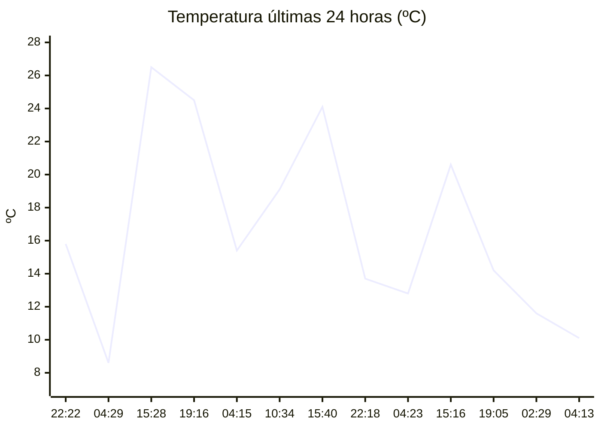

# rem-scrap

Actualización automática del clima para la estación Concarán.

## Últimos datos

| Campo | Valor |
| --- | --- |
| Estación | Concarán |
| Hora | 04:12 |
| Temperatura | 10,1 ºC |
| Humedad | 99,8 % |
| Lluvia (1h) | 0,9 mm |
| Lluvia (24h) | 0,9 mm |
| Lluvia (30d) | 41,5 mm |
| Lluvia (Año) | 553,5 mm |
| Rad. Solar | 0,0 W/m2 |
| Temp Max Hoy | 12 ºC a las 00:01 |
| Temp Min Hoy | 10 ºC a las 03:57 |
| VPS (VPD) | 0 kPa (bajo) |

## Resumen IA

Estación Concarán, 04:12 h – madrugada fresca y extremadamente húmeda, con cielo sin radiación solar.  
Temperatura actual 10,1 ºC se sitúa apenas 0,1 ºC por encima de la mínima del día (10 ºC) y a 1,9 ºC de la máxima (12 ºC); el rango térmico del día es de 2 ºC, por lo que el clima está mucho más próximo al extremo frío.  
La humedad relativa es 99,8 % y el VPD es 0 kPa, valor muy bajo que indica aire saturado; la transpiración de las plantas será mínima y el riesgo de desarrollo de hongos y enfermedades por humedad estancada es alto.  
En la última hora se registró 0,9 mm de lluvia (igual al total de 24 h), lo que refuerza la humedad del suelo y del aire. La radiación solar es nula, como corresponde a la hora nocturna, por lo que no hay aporte de energía solar.  
Recomendación: ventilar ligeramente los cultivos o los invernaderos para reducir la humedad del aire y prevenir problemas fúngicos.

## Tendencia últimas 24 h

## Fuente

Datos extraídos de [clima.sanluis.gob.ar](https://clima.sanluis.gob.ar/Estacion.aspx?estacion=8).

## Generado automáticamente

Este archivo fue actualizado el 24 de octubre de 2026 a las 07:13:24.
