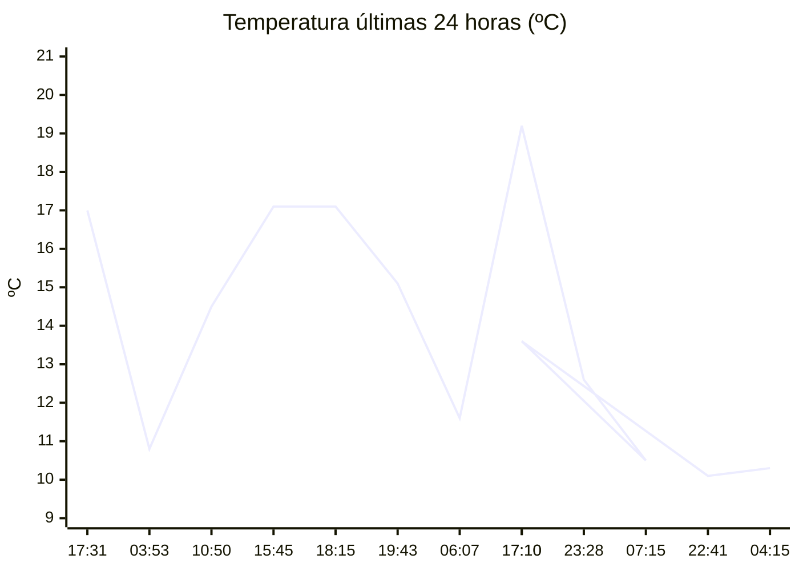

# rem-scrap

Actualización automática del clima para la estación Concarán.

## Últimos datos

| Campo | Valor |
| --- | --- |
| Estación | Concarán |
| Hora | 04:14 |
| Temperatura | 10,3 ºC |
| Humedad | 99,8 % |
| Lluvia (1h) | 0,1 mm |
| Lluvia (24h) | 1,0 mm |
| Lluvia (30d) | 26,7 mm |
| Lluvia (Año) | 538,6 mm |
| Rad. Solar | 0,0 W/m2 |
| Temp Max Hoy | 11 ºC a las 03:31 |
| Temp Min Hoy | 9 ºC a las 01:15 |
| VPS (VPD) | 0 kPa (bajo) |

## Resumen IA

Estación Concarán, 04:14 h: madrugada fresca y extremadamente húmeda, con cielo nublado o con niebla.  
Temperatura actual 10,3 ºC se sitúa dentro del rango del día (9 – 11 ºC). El rango térmico es de 2 ºC; la lectura actual está 0,7 ºC por debajo del máximo y 1,3 ºC por encima del mínimo, por lo que se aproxima más al extremo máximo.  
Humedad relativa 99,8 % y VPD 0 kPa indican aire saturado, sin demanda de vapor. Con VPD prácticamente nulo, la transpiración de las plantas es mínima y el ambiente favorece la proliferación de hongos o enfermedades por exceso de humedad.  
Lluvia reciente de 0,1 mm en la última hora y 1,0 mm en 24 h aportan humedad adicional; la radiación solar está en 0 W/m2, típica de la madrugada sin luz solar.  
Recomendación: mantener una ventilación ligera y evitar riegos adicionales para prevenir problemas de hongos.

## Tendencia últimas 24 h

## Fuente

Datos extraídos de [clima.sanluis.gob.ar](https://clima.sanluis.gob.ar/Estacion.aspx?estacion=8).

## Generado automáticamente

Este archivo fue actualizado el 14 de octubre de 2026 a las 07:15:23.
