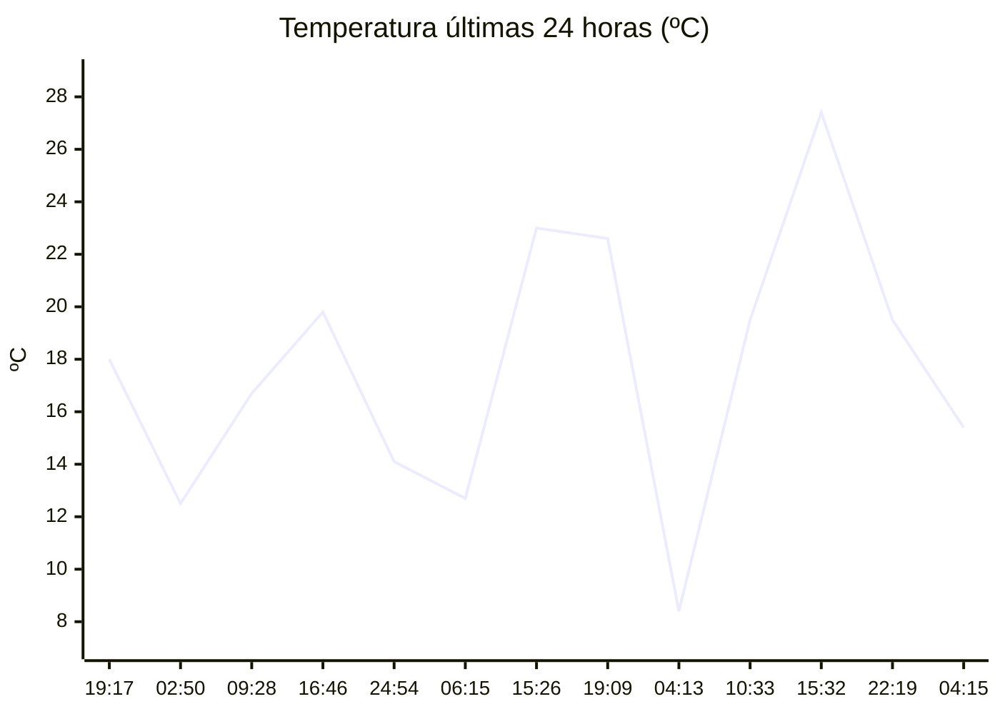

# rem-scrap

Actualización automática del clima para la estación Concarán.

## Últimos datos

| Campo | Valor |
| --- | --- |
| Estación | Concarán |
| Hora | 04:14 |
| Temperatura | 15,4 ºC |
| Humedad | 99,8 % |
| Lluvia (1h) | 2,1 mm |
| Lluvia (24h) | 2,1 mm |
| Lluvia (30d) | 38,2 mm |
| Lluvia (Año) | 550,2 mm |
| Rad. Solar | 0,0 W/m2 |
| Temp Max Hoy | 22 ºC a las 00:01 |
| Temp Min Hoy | 15 ºC a las 03:54 |
| VPS (VPD) | 0 kPa (bajo) |

## Resumen IA

Estación Concarán, 04:14 h – madrugada fresca y extremadamente húmeda. La temperatura actual es 15,4 ºC, apenas 0,4 ºC por encima de la mínima de hoy (15 ºC) y distante 6,6 ºC de la máxima (22 ºC), lo que define un rango térmico de 7 ºC y sitúa al aire en el extremo frío del día. La humedad relativa está al 99,8 % y el VPD (vps) registra 0 kPa, indicando que el aire está saturado; la transpiración de las plantas será mínima y el riesgo de desarrollo de hongos por humedad estancada es alto. En la última hora cayó 2,1 mm de lluvia, mismo valor acumulado en 24 h, lo que refuerza la condición de humedad y mantiene el suelo mojado; la radiación solar es nula (0,0 W/m2) por ser noche. Recomendación: ventilar el cultivo y, si es posible, aplicar fungicidas preventivos o cubrir las plantas para evitar problemas de moho.

## Tendencia últimas 24 h

## Fuente

Datos extraídos de [clima.sanluis.gob.ar](https://clima.sanluis.gob.ar/Estacion.aspx?estacion=8).

## Generado automáticamente

Este archivo fue actualizado el 22 de octubre de 2026 a las 07:15:50.
